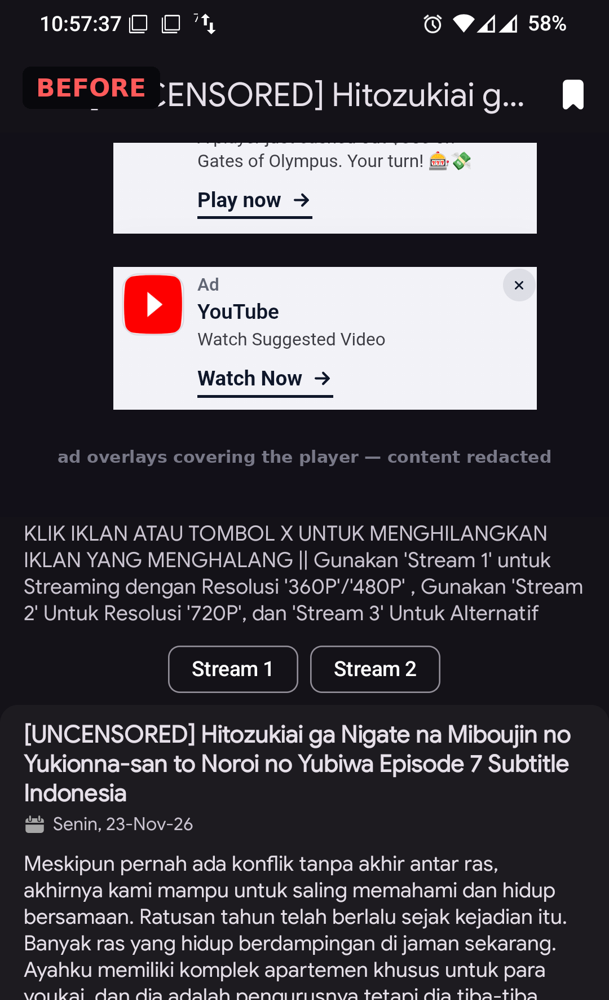
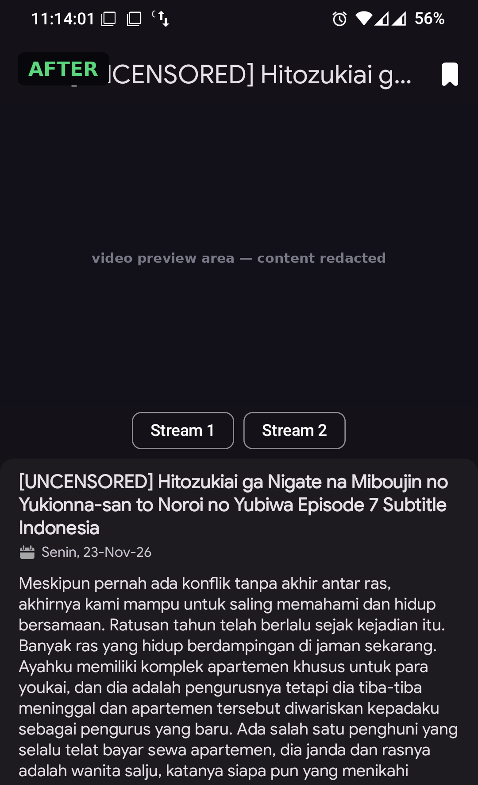

# re-kucing-peduli

[](https://github.com/kucingsakti/re-kucing-peduli/releases/latest)
[](https://github.com/kucingsakti/re-kucing-peduli/releases/latest/download/KucingUnlock-v1.0.0.apk)
[](https://github.com/kucingsakti/re-kucing-peduli/releases)


-informational)


> **⬇️ Download:** grab the prebuilt module from the
> **[latest release](https://github.com/kucingsakti/re-kucing-peduli/releases/latest)** —
> [`KucingUnlock-v1.0.0.apk`](https://github.com/kucingsakti/re-kucing-peduli/releases/latest/download/KucingUnlock-v1.0.0.apk)
> (SHA-256 `28e3a9aa…49b55e`). Install steps are in the **KucingUnlock** section below.

Reverse-engineering case study of an Android streaming application protected by a
commercial RASP (Runtime Application Self-Protection) SDK. The project documents the
full workflow — static analysis, string/crypto recovery, native decompilation, dynamic
instrumentation, and a purpose-built Xposed module — used to analyse the app on a rooted
device, map its private API, and understand its anti-tamper and ad-delivery mechanisms.

> **Target:** `com.kcstream.cing` (label **"Kucing"** / NekoPoi), v2.5.3-build01
> **Protection:** Talsec **FreeRASP** v14.0.1 (`libtmlib.so`)
> **Platform studied:** Samsung M20 (`m20lte`), Android 15 / LineageOS 22.2, Magisk + Zygisk (Vector)

---

## ⚠️ Disclaimer

This repository is for **educational and security-research purposes only**. All analysis
was performed on the author's **own device** and **own installed copy** of the application.

- It is **not** affiliated with, endorsed by, or representative of the application's authors.
- No credentials, user data, or server-side systems were attacked; work is limited to
  client-side analysis of software running locally.
- Decompiled/third-party artifacts are retained only as analysis evidence and remain the
  property of their respective owners.
- Do not use any material here to infringe copyright, violate a service's terms, or target
  systems you do not own or are not authorised to test. **You are responsible for your use.**

---

## Highlights

| Area | Result |
|------|--------|
| **Anti-tamper** | FreeRASP threat model fully mapped; fatal threats are **emulator / tamper / hooks** (root is *tolerated*). Single Java choke point identified: `u1.c.onReceive`. |
| **String obfuscation** | XOR string cipher recovered (`C.a(C.c(hex))`), 789 strings decrypted offline. |
| **Private API** | Base URL, path, `Token`, and `AppSignature` recovered from `libnative-lib.so` (Base64-in-native) and confirmed live. |
| **Endpoints** | `recent`, `comingsoon`, `listall`, `search`, `post`, `series`, `updateApp` mapped with parameters. |
| **Video pipeline** | Player resolves to **DoodStream** (`playmogo.com`); full chain reversed down to the direct MP4 URL, with a working resolver script. |
| **Tooling** | `KucingUnlock` Xposed/Vector module: RASP bypass, API/endpoint/token logger, and a WebView ad-blocker. |

---

## Ad-blocker — before / after

The module strips the in-player ad overlays (served by rotating malvertising domains),
the ad-instruction note, and the leftover empty ad containers.

| Before | After |
|:------:|:-----:|
|  |  |

> Screenshots are redacted — the video-preview area is blacked out; only the UI chrome
> and the (SFW) ad creatives are shown.

---

## Repository layout

```
.
├── apk/                 # pulled base.apk
├── native/              # extracted arm64 .so (libnative-lib, libtmlib, libclib, ...)
├── jadx/                # jadx decompilation (Java)
├── decompiled/          # apktool output (smali + resources)
├── loot/                # findings & scripts  ◀ start here
│   ├── API_FINDINGS.md        # base URL / path / Token / AppSignature (static)
│   ├── CONFIRMED_LIVE.md      # values confirmed at runtime
│   ├── ENDPOINTS.md           # full endpoint map + response models
│   ├── VIDEO_RESOLVE.md       # DoodStream resolution chain
│   ├── resolve_playmogo.sh    # embed URL -> direct MP4
│   ├── decrypt_strings.py     # offline XOR string decryptor
│   └── decrypted_*.txt        # bulk-decrypted strings
├── module/              # KucingUnlock — Xposed/Vector module (source + build)
│   ├── src/app/...            # Hook.java (module logic)
│   ├── src/stub/...           # compile-only Xposed API stubs
│   ├── AndroidManifest.xml
│   ├── assets/xposed_init
│   ├── build.sh              # no-Android-Studio build pipeline
│   └── KucingUnlock.apk      # prebuilt module
├── notes/               # recon.md (threat model + logs) and screenshots
├── frida/               # early Frida recon scripts
└── capture.sh           # live endpoint/token capture helper
```

---

## Methodology

1. **Acquisition & recon** — pull the APK, enumerate permissions, native libs, signer, and
   packers (`apkid` → *FreeRASP*).
2. **Static analysis** — decompile with `jadx` + `apktool`; identify the Talsec SDK and the
   threat-dispatch receiver.
3. **String recovery** — reverse the XOR cipher and bulk-decrypt obfuscated strings
   (`loot/decrypt_strings.py`), revealing threat names and internal constants.
4. **Native analysis** — decompile `libnative-lib.so` with radare2; recover the Base64-encoded
   API base URL / path / key / signature from the `Service.getAPI*()` JNI methods.
5. **Dynamic instrumentation** — build an Xposed module to neutralise the threat reaction and
   log the live OkHttp traffic (endpoints + headers).
6. **Media pipeline** — follow the player WebView to the DoodStream embed and reverse the
   `pass_md5` → direct-MP4 resolution chain.

Full details and evidence are in [`notes/recon.md`](notes/recon.md) and [`loot/`](loot/).

---

## KucingUnlock — Xposed / Vector module

A single module (`com.re.kucingunlock`, scoped to `com.kcstream.cing`) that provides:

- **RASP bypass** — consumes the FreeRASP threat broadcast (`u1.c.onReceive`) so the app runs
  on a rooted / hooked / "emulated" device. No APK repackaging — original signature preserved.
- **API logger** — logs `Service.getAPIUrl/Path/Key/Signature`, every request header
  (`Token`, `AppSignature`, `Authorization`), and each request URL. Tag: `KUCING`.
- **Ad-blocker**
  - *In-app:* neutralises the Unity Ads interstitial and blocks external ad-intent launches.
  - *Player/WebView:* **allowlist (deny-by-default)** resource filter — only known
    player/API/CDN hosts pass, defeating the rotating malvertising domains while keeping
    playback intact.
  - *Cosmetic:* hides the ad-instruction note and collapses leftover ad-container views
    app-wide via a recursive view-tree scan.

### Build

No Android Studio required. The pipeline uses a userspace toolchain
(ECJ + D8 + `aapt` + `apksigner`); see `module/build.sh`.

```bash
# prerequisites (userspace): android.jar, r8.jar (D8), ecj.jar  -> see build.sh header
cd module
bash build.sh            # -> module/KucingUnlock.apk
```

### Install (Vector / LSPosed)

```bash
adb install -r module/KucingUnlock.apk
# enable + scope via Vector CLI (or the Vector/LSPosed manager UI):
adb shell su -c 'sh /data/adb/modules/zygisk_vector/cli modules enable com.re.kucingunlock'
adb shell su -c 'sh /data/adb/modules/zygisk_vector/cli scope set com.re.kucingunlock com.kcstream.cing/0'
# then force-stop & relaunch the target app
```

### Live capture

```bash
./capture.sh                                  # stream endpoints + headers to loot/
# or manually:
adb logcat -s VectorLegacyBridge | grep KUCING
```

---

## Video resolver

```bash
bash loot/resolve_playmogo.sh https://playmogo.com/e/<embedId>
# -> prints a direct MP4 URL (HTTP 200, video/mp4). Fetch with Referer: https://playmogo.com/
```

The embed `id` is taken from the `post?id=` response body; see
[`loot/VIDEO_RESOLVE.md`](loot/VIDEO_RESOLVE.md) for the full chain.

---

## Tooling

`jadx` · `apktool` · `dex2jar` · `apkid` · `radare2` · `aapt` / `apksigner` · `adb` ·
`Frida` · `Vector` (Xposed-compatible framework) · ECJ + D8 (userspace module build).

## Status

Analysis complete. Module is built, installed, and verified on-device. See the commit
history for the incremental progression of findings and module features.

## License

Original work in this repository is released under the [MIT License](LICENSE).
Third-party and decompiled artifacts are **not** covered and remain the property of
their respective owners — see the license scope note and the disclaimer above.
